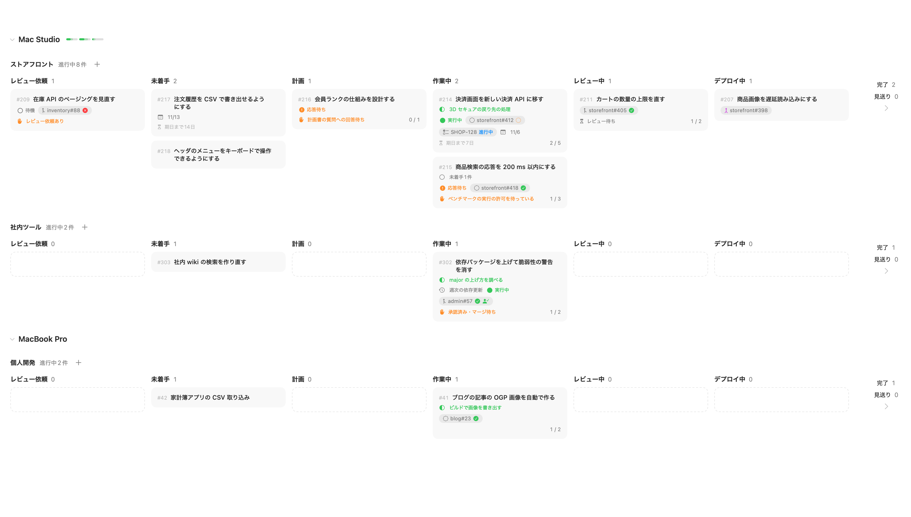
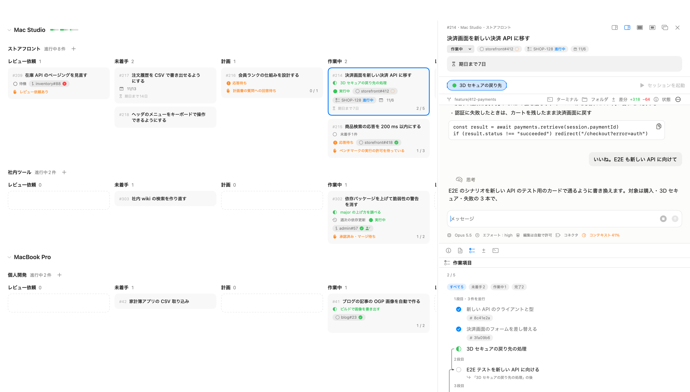
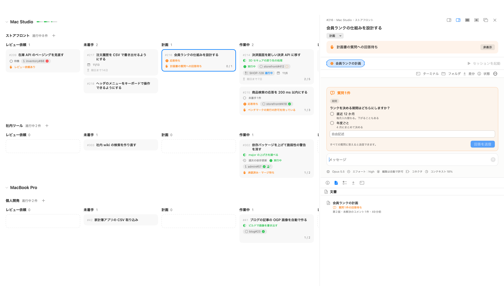
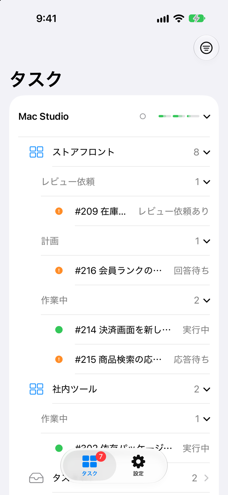
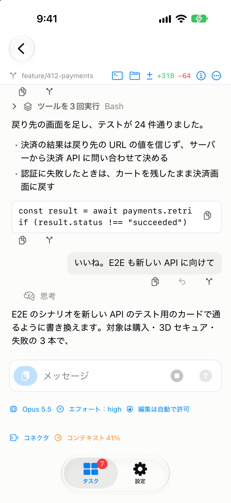
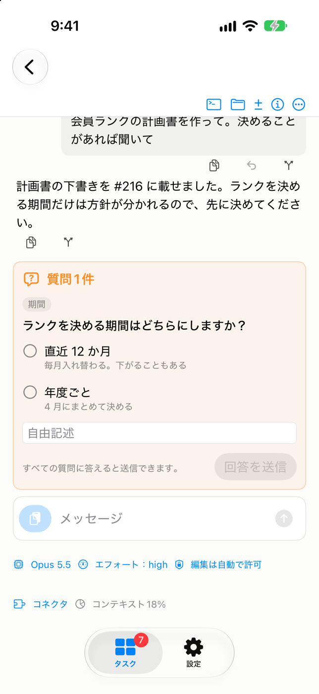

# taskboard

何台もの Mac で動かしている Claude Code と Codex のセッションを、タスクのカードに結んで 1 枚のボードで見る。
返事を待っているセッションだけを開き、その場で答えて続きを指示できる。

macOS・iPadOS・iOS のアプリと、各 Mac に常駐する daemon でできている。

[English](README.md) · [できること](#できること) · [動かす](docs/getting-started.md) · [しくみ](docs/architecture.md) · [ドキュメント](docs/README.md)

<picture>
  <source media="(prefers-color-scheme: dark)" srcset="docs/images/board-dark.png">
  
</picture>

## なぜ作ったか

エージェントに仕事を任せると、セッションが何本も同時に走る。
Mac が 3 台あると、どこで何が動いていて、どれが人の返事を待っているのかを追い切れなくなる。

taskboard では 1 つのタスクが 1 枚のカードになり、カードの上に今の状態（実行中か応答待ちか、PR の CI、作業項目の進み）が出る。
エージェントは MCP でカードを自分で進め、計画書を載せ、人に質問する。
人はボードを眺めて、回答と承認が要るカードだけを開けばよい。

## できること

- **全部の Mac を 1 枚のボードに**：案件ごとの列にカードを並べ、マシンをまたいで 1 画面に出す。PR を出したら「レビュー中」へ、マージしたら「デプロイ中」へとカードが進む
- **カードから起動して、会話で続ける**：Claude Code か Codex をカードから起こし、会話をチャットの形で読み書きする。画像を添えて送れ、端末の画面をそのまま開くこともできる
- **質問と承認にボタンで答える**：AskUserQuestion と権限の確認は、会話の中のカードで答える。iPhone と iPad にも通知が届く
- **エージェントが自分で報告する**：作業項目の進みと待ちの理由、計画書、レビューの依頼を、エージェントが MCP でタスクに載せる
- **PR と利用枠を一緒に見る**：結んだ PR の CI とレビュー、Claude Code と Codex の利用枠の残りを同じ画面に出す
- **定期起動とオーケストレーター**：cron で決まった仕事を起こし、タスクに結ばない窓口のセッションに何でも頼める

詳しい一覧は [docs/features.md](docs/features.md)。

<picture>
  <source media="(prefers-color-scheme: dark)" srcset="docs/images/task-dark.png">
  
</picture>

<picture>
  <source media="(prefers-color-scheme: dark)" srcset="docs/images/ask-dark.png">
  
</picture>

<p>
  
  
  
</p>

画面のデータはすべて架空のもの（`scripts/fixtures/make-demo.py` が作る）。

## 動かす

必要なのは macOS 26 以降、Swift 6.2 以降、Claude Code か Codex。アプリを作るには Xcode 27 と [XcodeGen](https://github.com/yonaskolb/XcodeGen) も使う。

```sh
swift build
.build/debug/taskboard install-launchd   # daemon・agent host を launchd に入れる
.build/debug/taskboard install-hooks     # Claude Code の hook を足す（--dry-run で変更だけ見られる）
claude mcp add --scope user --transport stdio taskboard -- ~/.local/bin/taskboard mcp
scripts/build-mac.sh                     # Mac のアプリを ~/Applications に入れる
```

アプリは既定で ad hoc 署名になる。自分の Apple Developer の Team で署名するときと iPhone の実機に入れるときは、`App/Signing.local.xcconfig.example` を `App/Signing.local.xcconfig` に写して値を書く。

別の Mac や iPhone から繋ぐ方法と、置き場所の注意は [docs/getting-started.md](docs/getting-started.md)。

## ドキュメント

| 文書 | 中身 |
|---|---|
| [docs/getting-started.md](docs/getting-started.md) | 必要なもの、入れ方、別の端末から繋ぐ方法 |
| [docs/features.md](docs/features.md) | できることの一覧 |
| [docs/architecture.md](docs/architecture.md) | しくみとリポジトリの中身 |
| [docs/daemon.md](docs/daemon.md) | daemon の動きと API の仕様 |
| [docs/development.md](docs/development.md) | ビルド、テスト、動作確認、依存の版 |
| [docs/ui-system.md](docs/ui-system.md)・[docs/ui-copy.md](docs/ui-copy.md) | 画面の作りと文言の決まり |

## 状態

作者の環境で使うために 2026 年 10 月から作っている個人の道具で、ほかの環境でそのまま動くとは限らない。画面と文書は日本語だけ。配布しているのはソースだけで、ビルド済みのアプリは無い。

## ライセンス

[MIT](LICENSE)
