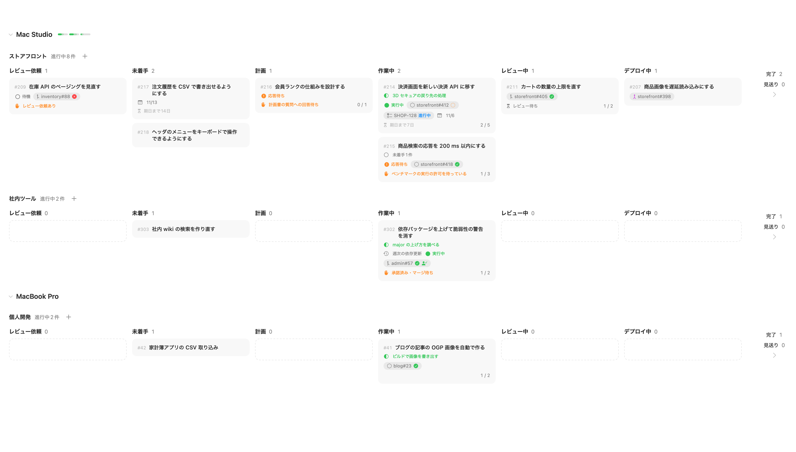
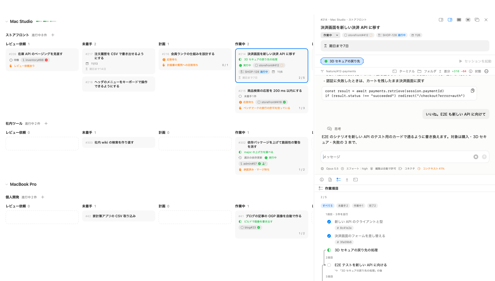
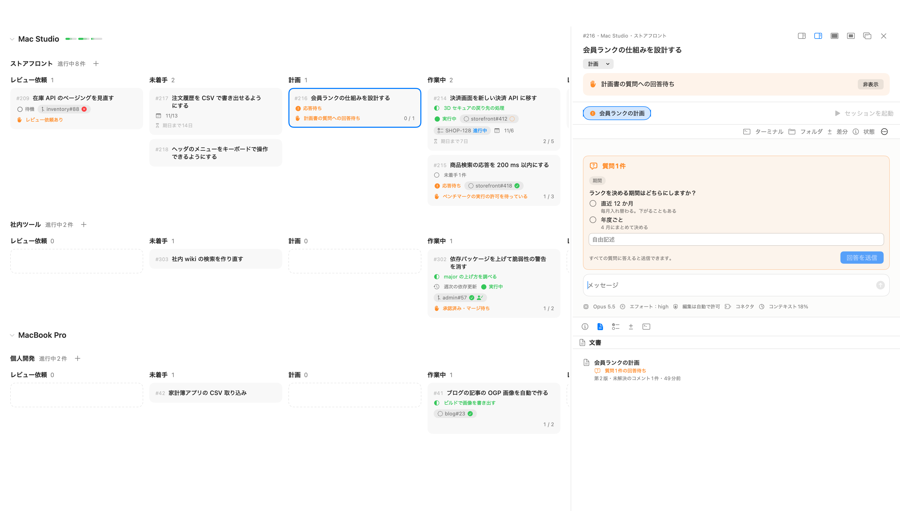
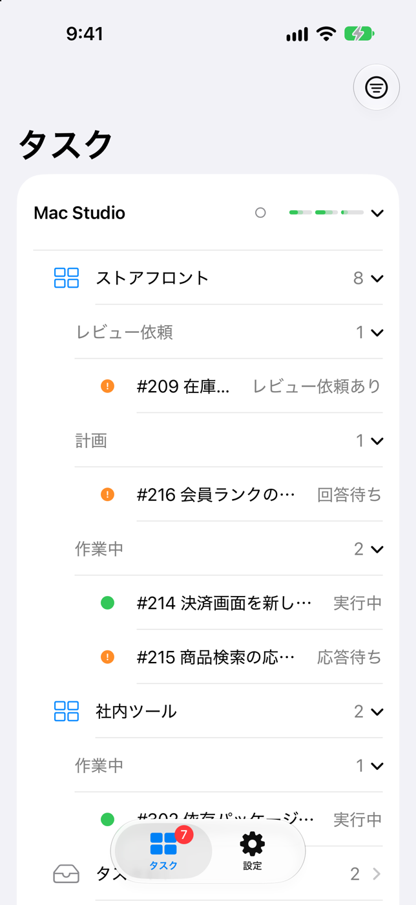
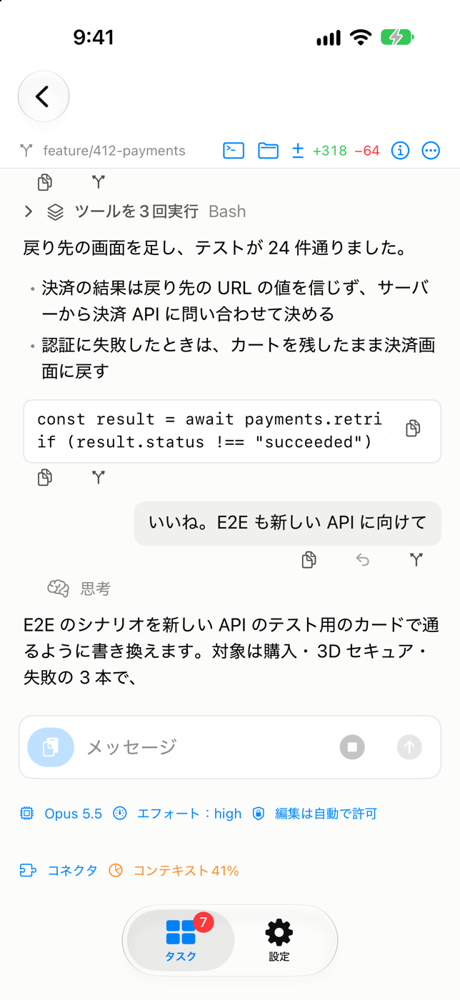
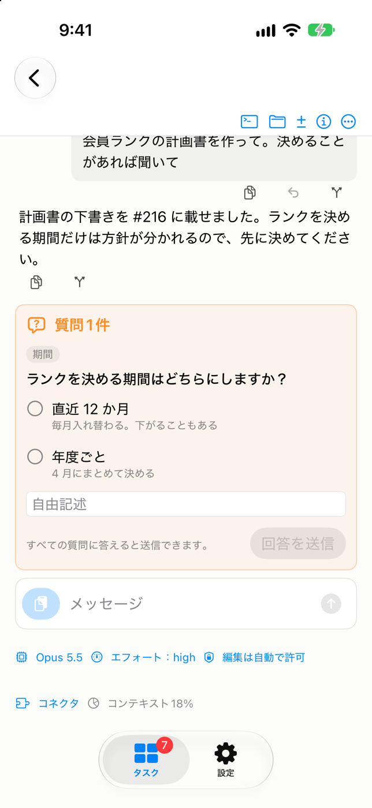

# taskboard

A board for the Claude Code and Codex sessions running across all of your Macs. Each session is tied to a task card, so you open only the ones waiting on you, answer them in place, and tell them what to do next.

taskboard is a macOS, iPadOS and iOS app plus a daemon that runs on each Mac.

[日本語](README.ja.md) · [Features](#features) · [Quick start](#quick-start) · [Documentation](#documentation)

<picture>
  <source media="(prefers-color-scheme: dark)" srcset="docs/images/board-dark.png">
  
</picture>

## Why

Once you hand work to agents, several sessions run at the same time. With three Macs, it gets hard to keep track of what is running where and which session is waiting for an answer.

In taskboard, one task is one card. The card shows the current state: whether the session is running or waiting, the CI of its pull request, and how far its work items have got. Agents move their own cards through MCP, attach plans, and ask you questions. You look at the board and open only the cards that need an answer or an approval.

## Features

- Cards from every Mac sit in per-project columns on one screen. A card moves to the review column when its pull request is ready for review, and to the deploy column when it is merged.
- Launch Claude Code or Codex from a card and read and write the conversation as a chat. You can attach images, or open the session's terminal as it is.
- AskUserQuestion and permission prompts appear as cards in the conversation, and you answer them with buttons. Notifications reach your iPhone and iPad too.
- Through MCP, agents post work-item progress and the reason they are blocked, publish plans, and request reviews on the task.
- The CI and review state of linked pull requests, and the remaining Claude Code and Codex usage, show next to the tasks.
- Routine jobs start on a cron schedule, and an orchestrator session that is not tied to any task takes whatever you hand it.

The full list is in [docs/features.md](docs/features.md) (Japanese).

<picture>
  <source media="(prefers-color-scheme: dark)" srcset="docs/images/task-dark.png">
  
</picture>

<picture>
  <source media="(prefers-color-scheme: dark)" srcset="docs/images/ask-dark.png">
  
</picture>

<p>
  
  
  
</p>

All data in these screenshots is made up (generated by `scripts/fixtures/make-demo.py`).

## Quick start

You need macOS 26 or later, Swift 6.2 or later, and Claude Code or Codex. Building the app also needs Xcode 27 and [XcodeGen](https://github.com/yonaskolb/XcodeGen).

```sh
swift build
.build/debug/taskboard install-launchd   # put the daemon and the agent host under launchd
.build/debug/taskboard install-hooks     # add the Claude Code hooks (--dry-run shows the change only)
claude mcp add --scope user --transport stdio taskboard -- ~/.local/bin/taskboard mcp
scripts/build-mac.sh                     # build the Mac app into ~/Applications
```

The app is signed ad hoc by default. To sign with your own Apple Developer team, or to run it on an iPhone, copy `App/Signing.local.xcconfig.example` to `App/Signing.local.xcconfig` and fill in your values.

Connecting from another Mac or an iPhone, and where to run the daemon safely, are covered in [docs/getting-started.md](docs/getting-started.md).

## Documentation

The app and the documentation are in Japanese.

| Document | Contents |
|---|---|
| [docs/getting-started.md](docs/getting-started.md) | Requirements, installation, connecting other devices, signing |
| [docs/features.md](docs/features.md) | What taskboard can do |
| [docs/architecture.md](docs/architecture.md) | How it works and what is in the repository |
| [docs/daemon.md](docs/daemon.md) | Daemon behavior and the API |
| [docs/development.md](docs/development.md) | Building, testing, checking changes, dependency versions |
| [docs/ui-system.md](docs/ui-system.md), [docs/ui-copy.md](docs/ui-copy.md) | Layout rules and UI copy rules |

## Status

taskboard is a personal tool, built since October 2026 for the author's own setup. It may not work as-is in other environments, and there are no binary releases: build it from source.

## License

[MIT](LICENSE)
