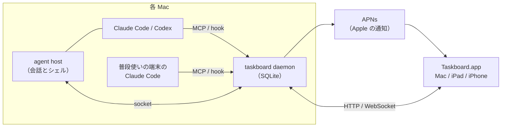

# しくみ

- **daemon**（`taskboard serve`）：各 Mac に launchd で常駐する。セッションの状態を持ち、ボードとタスクを SQLite に保存し、HTTP と WebSocket で配る。PR の状態は `gh` で取りに行く
- **会話**：taskboard が起こすセッションは全部、agent host（`taskboard agent-host`）が動かす。Claude Code は stream-json で、Codex は `codex app-server` で起こし、daemon は出来事を読んでアプリのチャットに流す。会話の作業フォルダのシェルも host の擬似端末に置く。CLI の子とシェルを持つのは host なので、daemon を入れ替えても会話とシェルは止まらない
- **普段使いの端末のセッション**：自分の端末で起こした Claude Code は、hook でタスクに結ばれ、MCP でボードを扱う。taskboard はその画面を持たない
- **アプリ**（`Taskboard.app`）：SwiftUI で書いた Mac と iPad、iPhone のアプリ。何台の daemon にでも繋ぎ、全部のマシンのボードを 1 画面に並べる
- **エージェント側の接続**：Claude Code には 2 つの経路で繋ぐ
  - **hook**：起動のたびにセッションをタスクに結び、タスクの番号と列の説明を会話に入れる
  - **MCP**（`taskboard mcp`）：ボード、タスク、作業項目、文書、セッション、定期起動を扱うツールを持つ。エージェントはここからカードと文書を扱う

仕様の細部は [daemon.md](daemon.md)。

## リポジトリの中身

| 場所 | 中身 |
|---|---|
| `Sources/TaskboardKit` | アプリと daemon が共有するモデルと API の型、daemon の client |
| `Sources/TaskboardDaemon` | daemon。会話、状態、保存（GRDB）、HTTP と WebSocket の API（Hummingbird） |
| `Sources/taskboard` | CLI。`serve`、`mcp`、`hook`、`agent-host`、`install-launchd` など |
| `App/` | SwiftUI のアプリ（`project.yml` から XcodeGen で生成）、fixtures、snapshot test |
| `scripts/` | ビルド、snapshot test、画面の確かめ方、fixtures の生成 |
